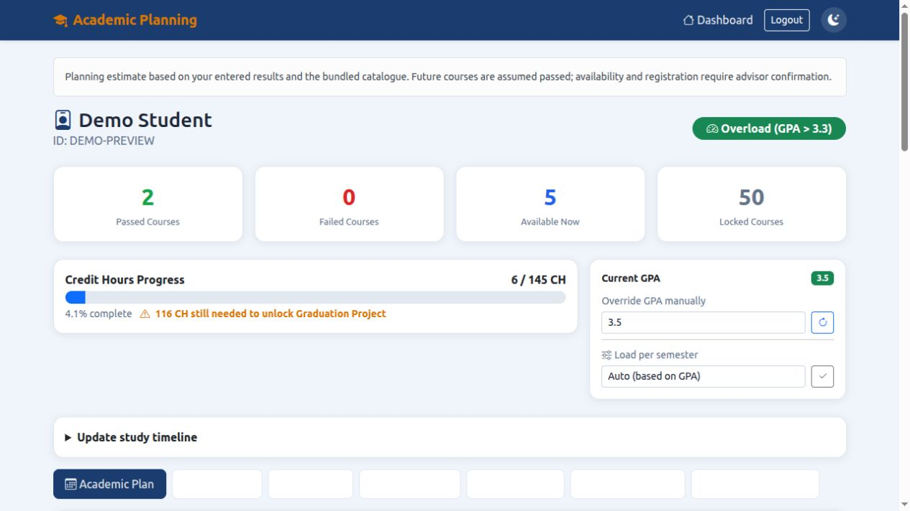

# Academic Planning

A Flask web app that turns a student's recorded results into a semester-by-semester course roadmap. Sign in with a registration number and password, record passed and failed courses, and explore the remaining prerequisites, credit load and retakes.

Developed as a student academic-advising project. This version improves the supplied application while keeping its Python, Jinja, Bootstrap and JSON-file architecture.



## Features

- Registration-number/password accounts with hashed passwords.
- Grade entry and editing, credit-weighted GPA, and completed-credit tracking.
- Course status: passed, failed, available and locked with missing prerequisites.
- Deterministic planning that checks prerequisites against earlier completed terms.
- Separate Graduation Project I and II, with the bundled 122-credit eligibility rule.
- GPA-based 14 / 19 / 21 credit limits, manual load scenarios and next-term overload preview.
- Summer projections limited to nine credits and three eligible retake/overdue courses.
- CSV plan download, light/dark theme and responsive course cards.
- Private student records, CSRF protection and validated course/grade input.

## Quick start

Python **3.10 or newer**:

```sh
python3 -m venv .venv
source .venv/bin/activate
python -m pip install -r requirements.txt
python app.py
```

On Windows, activate with `.venv\Scripts\activate` instead. Open [localhost:5000](http://localhost:5000), choose **Create Account**, and use a new registration number and a password of 8-128 characters. Enter only the results you already have. Leave courses you have not taken blank.

**Last Completed Regular Semester** is 0 for a new student. For a student who finished Sem 4, enter 4: projected terms begin at Sem 5. The total-semester field is a target timeline, not a guarantee that all courses fit within it.

Accounts belong to this local app. It does not connect to a university portal or validate a registration number against an official student directory. Use a separate password, rather than your university password. No real student records or demo passwords are distributed in the repository.

## Planning model

| Rule | Behavior |
|---|---|
| Prerequisites | Must have passed before the planned term starts; no same-term prerequisite completion |
| Retakes | Have priority when eligible; may be scheduled in regular terms or eligible summer sessions |
| GPA below 2.0 | 14 credit hours per regular term |
| GPA from 2.0 through 3.3 | 19 credit hours per regular term |
| GPA above 3.3 | 21 credit hours per regular term |
| Summer | After every second regular term; at most 9 credits / 3 eligible retake or overdue courses |
| Graduation projects | At least 122 previously completed credits; Project II must follow Project I |
| Future outcomes | All projected courses are assumed passed |
| Manual overrides | What-if scenarios; they do not constitute advisor approval |

The supplied catalogue contains **57 courses totaling 145 credits**. Its original README said 144. The app now derives the total from the actual data; the discrepancy has not been resolved against an official curriculum. Catalogue semester numbers are treated as earliest placement, not verified Fall/Spring availability.

This is a greedy feasible-plan generator, not an optimal graduation-time solver. It does not consider actual course offerings, timetable conflicts, seat availability, repeated-attempt institutional GPA rules, or academic approvals. Projections are estimates for discussion with an advisor. See [planning assumptions](docs/PLANNING.md).

## Data and configuration

Student records are stored in ignored `instance/students/` JSON files. Passwords use Werkzeug's salted password hashing. Writes use a temporary file followed by atomic replacement; a file lock serializes requests that modify records. This is suitable for a small prototype with a single local storage directory, not a distributed database.

| Environment variable | Default | Purpose |
|---|---|---|
| `SECRET_KEY` | Generated into ignored `instance/.session-key` | Signs the session cookie; use a private stable value for a shared deployment |
| `APP_DATA_DIR` | `instance/students/` | Override the private records directory |
| `COOKIE_SECURE` | `0` | Set to `1` when serving over HTTPS |
| `PORT` | `5000` | Local development port |

`.env.example` documents these variables; the app does not load `.env` automatically. Debug mode is off. The built-in server binds only to localhost. Public deployment requires a WSGI server, HTTPS, request/login rate limiting, backups and operational review. Uploading this repository to GitHub does not host a running web app.

Legacy records from the supplied name-only login have no password hash and cannot sign in. They are not automatically claimable by entering the old name/ID. No old records were present in the supplied archive. If you have them elsewhere, migrate them privately with verified ownership before use.

## Verification

41 automated tests pass locally. Browser checks exercised registration, plan generation and grade updates with fictional data. No official curriculum or real student account was used.

## Tests

```sh
python -m pip install -r requirements-dev.txt
python -m pytest -q
```

Tests cover GPA thresholds, planning invariants across varied transcripts, complete course coverage, project order and eligibility, input validation, CSRF, account isolation, grade updates and CSV export. If unrelated system pytest plugins interfere, use `PYTEST_DISABLE_PLUGIN_AUTOLOAD=1 python -m pytest -q`.

## Structure

```text
app.py                 Flask routes, validation and session protection
planner.py             GPA, course status and deterministic planning
file_manager.py        Validated and atomic JSON persistence
data/courses_data.py   Supplied course catalogue
templates/             Jinja templates and interactive dashboard
tests/                 Planner and application regression tests
docs/                  Planning assumptions and changes from the supplied version
```

See [changes](docs/CHANGES.md) for the fixes. Original application supplied by **rashwan26**; this repository retains its course catalogue and interface foundation. Institutional branding describes the original project's intended study context and does not imply university endorsement.
